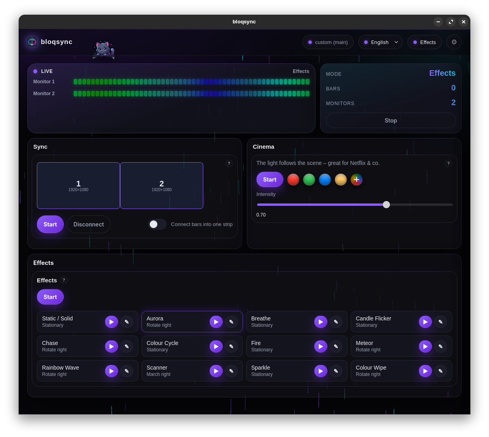
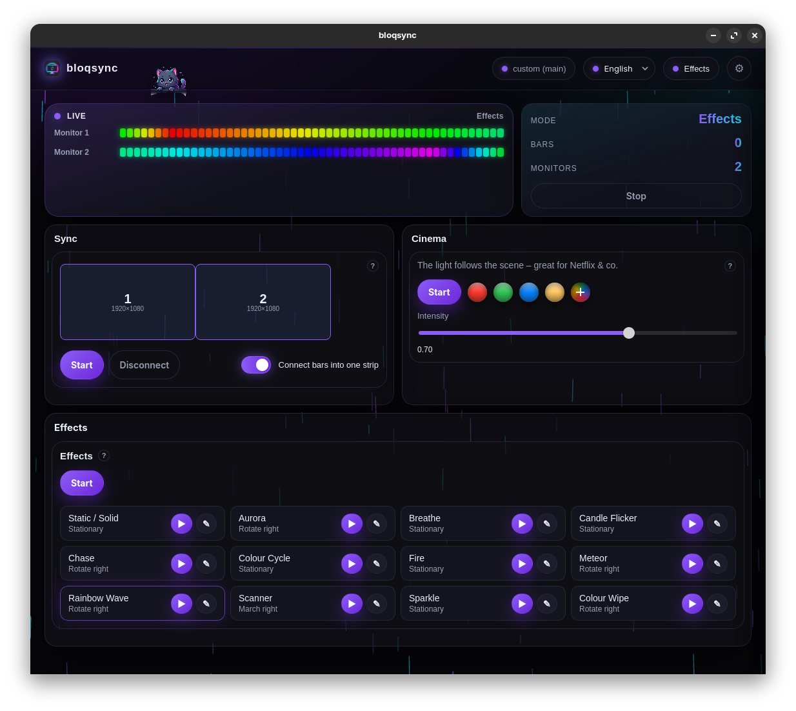
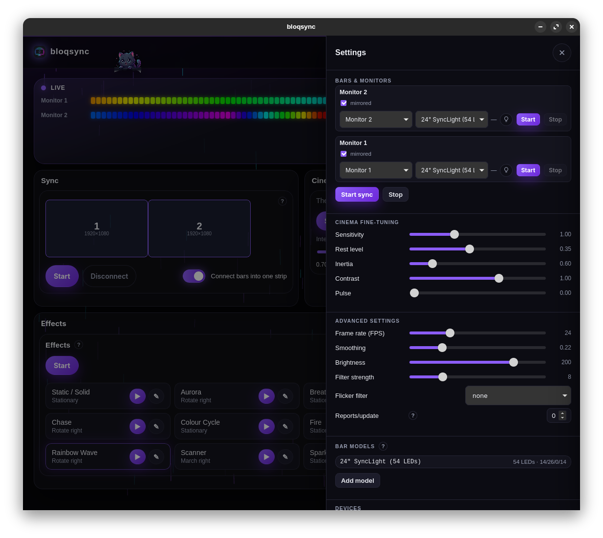
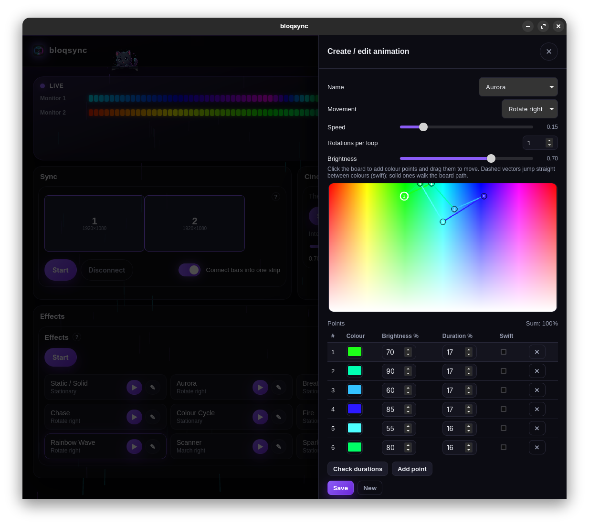

# bloqsync

[](https://github.com/niemanma/bloqsync/releases)
[](https://github.com/niemanma/bloqsync/releases)
[](LICENSE)
[](https://github.com/niemanma/bloqsync)
[](#architecture)

**bloqsync** brings high-performance ambient light ("Ambilight") screen
synchronisation to the **ROBOBLOQ SyncLight** USB LED bars on Linux
(GNOME / Wayland), and adds an audio-reactive **Cinema mode** for DRM content
such as Netflix. It is a native Rust + Tauri desktop app with a polished dark UI,
named profiles, plug-and-play auto-discovery and a small, hackable JSON
extension system for bar models and light effects.

| Effects — Aurora, per bar | Effects — Rainbow Wave, spanning both bars |
|---|---|
|  |  |

| Settings | Animation editor |
|---|---|
|  |  |

## Highlights

- **Plug & play GUI.** Connect your monitors once — the app discovers the bars,
  remembers everything and restores it on the next launch (no dialog after the
  first time).
- **Screen sync** with a full per-LED gradient, captured through **PipeWire**
  (`xdg-desktop-portal` ScreenCast) — no screenshot subprocesses.
- **Effects** (a dozen built-in animations, plus your own) that need no capture.
- **Connect bars into one strip** — run an effect once across two or more bars
  instead of replaying it on each one.
- **Cinema mode** — audio-reactive lighting for DRM/Netflix streams.
- **Named profiles** that store your settings *and* the bar ↔ monitor mapping.
- **Bar models** and **effects** are plain JSON — add your own by dropping in a
  file, or share them.
- **English & German** UI; adding a language is a single dictionary file.

> **AI-generated.** This repository was written by an AI model (DeepSeek V4.1
> Flash via OpenRouter) and is provided **as-is**, with no warranty and no
> maintenance guarantee — please **use it or fork it**.
>
> **License:** [Unlicense](LICENSE) — public domain. Do anything you want.
>
> **Not affiliated with Robobloq.** This project has **no connection** to
> Robobloq, Corsair, iCUE or any related company, and is not sponsored,
> endorsed, authorised or reviewed by any of them. "ROBOBLOQ", "SyncLight" and
> other names are trademarks of their respective owners, used here only
> descriptively to identify the device being driven. The reverse engineering was
> done **for interoperability** with a personally owned device.
>
> **Developed and tested** on the ROBOBLOQ SyncLight **24″ variant (54 LEDs,
> firmware 1.9.4)** on **Zorin OS 18.1 / GNOME 46 / PipeWire 1.0.5**, with **two
> monitors and two bars**. Other sizes are untested but can be described with a
> [bar model](#bar-models).

## Table of contents

- [Highlights](#highlights)
- [Features](#features)
- [Requirements](#requirements)
- [Installation](#installation)
- [Quick start](#quick-start)
- [Using the app](#using-the-app)
  - [Modes](#modes)
  - [Connect bars into one strip](#connect-bars-into-one-strip)
  - [Profiles](#profiles)
  - [Settings & expert controls](#settings--expert-controls)
- [Bar models](#bar-models)
- [Effects](#effects)
- [Languages](#languages)
- [Command line (CLI)](#command-line-cli)
- [Plug & play](#plug--play)
- [Hardware & protocol](#hardware--protocol)
- [Avoiding flicker](#avoiding-flicker)
- [Cinema mode](#cinema-mode)
- [Configuration & files](#configuration--files)
- [Architecture](#architecture)
- [Building from source](#building-from-source)
- [Troubleshooting](#troubleshooting)
- [Contributing](#contributing)
- [Status & limitations](#status--limitations)
- [Acknowledgements](#acknowledgements)
- [License](#license)

## Features

- Smooth screen sync with a full LED gradient (default **24 fps**, smoothing
  **0.22**; up to ~30 fps).
- True per-LED / per-zone output via the fast `setSyncScreen` protocol.
- **PipeWire** screen capture through the desktop portal (GNOME picker only once).
- **Effects**: *Static / Solid, Aurora, Breathe, Candle Flicker, Chase,
  Colour Cycle, Fire, Meteor, Rainbow Wave, Scanner, Sparkle, Colour Wipe* — plus
  a visual editor to build your own.
- **Cinema mode** (audio-reactive) for DRM content.
- **Bar models**: per-bar LED count and edge distribution (built-in + custom).
- **Named profiles**: create, load, rename and delete; they capture both the
  settings and the bar ↔ monitor assignment.
- Schematic **multi-monitor map** with monitor names and per-bar assignment.
- **English / German** UI, switchable and remembered.
- Device auto-discovery, stable identity (device UUID) and a watchdog that
  reconnects bars automatically after unplug/replug.

## Requirements

- **Linux with GNOME on Wayland** (developed on Zorin OS 18.1 / GNOME 46).
- **PipeWire** and `xdg-desktop-portal` (ScreenCast v5) for screen sync.
- **PulseAudio** or PipeWire's Pulse layer for Cinema mode.
- One or more **ROBOBLOQ SyncLight** bars (tested: 24″, 54 LEDs, firmware 1.9.4).

The prebuilt `.deb` pulls in the runtime libraries automatically. Building from
source additionally needs the development packages listed in
[Building from source](#building-from-source).

## Installation

### Prebuilt package (recommended)

Download the latest `.deb` from the [Releases](https://github.com/niemanma/bloqsync/releases)
page and install it:

```bash
sudo apt install ./bloqsync_*_amd64.deb
```

The package ships the app, the CLI, the udev rule (bar access + keyboard
interface suppression) and the desktop entry. **No Rust, no build tools.**

> The first time you start a screen sync, GNOME asks once per login for
> permission (a portal security feature). After that, the stored restore token
> makes everything start without a dialog.

### From source (developers)

```bash
git clone https://github.com/niemanma/bloqsync
cd bloqsync
./install.sh          # installs build deps, the udev rule, and bundles a .deb
```

or see [Building from source](#building-from-source).

## Quick start

1. Plug in your SyncLight bar(s). The bar's keyboard interface may open a browser
   tab on first plug-in — the installed udev rule silences that.
2. Launch **bloqsync** (application menu or `bloqsync-gui`).
3. In the **Sync** card, click **Connect monitors** and pick your monitors once.
4. Hit **Start**. Each bar is assigned to a monitor; adjust the assignment, the
   **mirror** direction and the **bar model** as needed.
5. Prefer a movie? Use **Cinema**. Want ambient light without a screen? Use
   **Effects**.

## Using the app

The window has three stacked sections — **Sync**, **Cinema** and **Effects** —
plus a hero **Live** strip that mirrors the actual LEDs in real time, a status
tile, and a gear button (top right) that opens the **Settings** panel.

### Modes

- **Sync** — samples the screen border of each captured monitor and streams the
  colours to the bars.
- **Cinema** — audio-reactive lighting (see [Cinema mode](#cinema-mode)).
- **Effects** — plays a time-based animation (no capture needed). The Live strip
  and the bar update instantly when you pick an effect or tweak its colour.

Only one *generative* mode (Cinema/Effects) runs at a time; the central **Stop**
button halts everything.

### Connect bars into one strip

The **Connect bars into one strip** switch (next to the Sync buttons) makes an
effect run **once across all bars** instead of once per bar:

- The bars are treated as one virtual strip, ordered **left → right by monitor**.
- The effect is rendered once for the combined LED count and then split across
  the bars; each bar's **mirror** direction is respected.
- With it off, the effect runs independently on every bar.

This works for two or more bars. (Screen sync already covers the whole desktop
continuously; Cinema drives brightness over one base colour, so the switch is
mainly relevant for effects.)

### Profiles

Profiles capture the current settings **and** the bar ↔ monitor assignment, so
you can switch setups with one click:

- The active profile is shown in the top bar. Changing anything shows
  `custom (<name>)` until you **Save to profile**.
- **Load** re-applies a profile; profiles can be **created, renamed and deleted**.

### Settings & expert controls

The **Settings** panel (gear icon) is a compact, categorised list:

- **Bars & monitors** — per-bar mirror, monitor assignment, model, identify, start/stop.
- **Cinema fine-tuning** — sensitivity, rest level, inertia, contrast, pulse.
- **Advanced settings** — frame rate, smoothing, brightness, filter strength,
  flicker filter, reports/update.
- **Bar models** — the model list, plus an **Add model** form (with an
  *Identification & protocol* sub-section).
- **Devices** — detected bars (UUID, LED count, firmware, path).
- **Create / edit animation** — opens the **animation editor** in its own panel.
- **Profiles** and **Automation** (start on login, start sync automatically).

## Bar models

A **bar model** describes one kind of LED bar: how it is **identified** on the
USB bus, its **LED count** and how those LEDs are **distributed** over the screen
edges, and the **protocol** used to drive it. Built-in models are one JSON file
each in [`gui/models/`](gui/models) and are embedded at build time; custom models
are stored in the config.

Each bar uses a model's `left / top / bottom / right` distribution to decide
which part of the screen each of its LEDs samples.

The default model (`gui/models/sync-24-54.json`) — 54 LEDs, 14/26/14:

```json
{
  "id": "sync-24-54",
  "name": "24\" SyncLight (54 LEDs)",
  "match": {
    "vendor_id": "1a86",
    "product_id": "fe07",
    "usage_page": "ff00"
  },
  "leds": 54,
  "left": 14,
  "top": 26,
  "bottom": 0,
  "right": 14,
  "protocol": {
    "kind": "robobloq-synclight",
    "report_size": 64,
    "max_sections_per_frame": 11,
    "section_size": 5,
    "max_leds": 254,
    "inter_frame_gap_ms": 3,
    "actions": {
      "sync_screen": "0x80",
      "section_led": "0x86",
      "brightness": "0x87",
      "device_info": "0x82"
    }
  }
}
```

- **`match`** — how a bar is recognised: USB `vendor_id` / `product_id` (hex)
  and the vendor `usage_page`. The core matches connected devices against these
  rules at start-up, so a different bar can describe its own identification.
- **`leds` / `left` / `top` / `bottom` / `right`** — total LED count and the edge
  distribution. `left + top + bottom + right` **must** equal `leds` (enforced by
  the app and by the add-model form).
- **`protocol`** — how the bar is spoken to: HID report size, sections per frame,
  section size, the highest addressable LED, the inter-frame pause and the
  action bytes. The core uses these values instead of hard-coded constants.

**To add a built-in model**, drop a JSON file in [`gui/models/`](gui/models) and
rebuild. **To add a model without rebuilding**, open **Settings → Bar models →
Add model**. If a model's LED count does not match the physical bar, the UI flags
it as a conflict.

## Effects

An **effect** (animation) is a closed chain of colour **points** on a
Hue × Saturation board, plus a **movement**. Each point has a brightness and a
**vector** to the next point with a duration and a mode: *normal* walks the
colour-board path, *swift* jumps straight between the two colours. Built-in
effects are one JSON file each in [`gui/animations/`](gui/animations) (embedded
at build time); user effects live in the config.

Calm: *Breathe, Colour Cycle, Candle Flicker, Aurora, Static*. Moving:
*Rainbow Wave, Chase, Meteor, Scanner, Fire, Sparkle, Colour Wipe*.

Example (`gui/animations/breathe.json`):

```json
{
  "id": "breathe",
  "name": "Breathe",
  "movement": "stationary",
  "speed": 0.25,
  "cycles": 7,
  "brightness": 0.9,
  "fps": 30,
  "points": [
    { "hue": 0.08, "sat": 0.85, "brightness": 1.0,  "duration": 50, "swift": false },
    { "hue": 0.08, "sat": 0.85, "brightness": 0.12, "duration": 50, "swift": false }
  ]
}
```

- **`movement`** — `stationary`, `rotate_left`, `rotate_right`, `march_left` or
  `march_right`.
- **`speed`** — fraction of the maximum rate (max = one rotation per second).
- **`cycles`** — rotations per loop when moving, seconds when stationary.
- **`points`** — `hue` and `sat` in `0..1`, `brightness` in `0..1`, `duration` a
  relative weight, `swift` = jump straight to the next colour.

**To add a built-in effect**, drop a JSON file in
[`gui/animations/`](gui/animations) and rebuild. **To create one interactively**,
open the **Animation editor** (Settings → *Open editor*), place points on the
board, set the movement/speed and **Save**.

## Languages

The UI ships with **English (default)** and **German**; switch in the top bar and
the choice is remembered. To add a language, copy
[`gui/ui/js/lang/en.js`](gui/ui/js/lang/en.js), translate the strings, and register
it in [`gui/ui/js/i18n.js`](gui/ui/js/i18n.js).

## Command line (CLI)

The package also installs a `bloqsync` CLI for scripting and diagnostics:

```bash
bloqsync list                         # connected bars
bloqsync info                         # firmware / LED count / UUID
bloqsync fill 255 0 0                 # persistent colour
bloqsync off | brightness 200
bloqsync gradient | pattern | stream 8
bloqsync bench 5                      # achievable frame rate
bloqsync calibrate 10                 # determine orientation
bloqsync capture-test 6               # capture only (picker dialog)
bloqsync sync 20                      # screen sync (choose monitor)
bloqsync sync 20 --reverse            # mirrored mounting
bloqsync sync 30 --fps 30 --smooth 0.4
bloqsync freeze 15                    # freeze one frame (flicker test)
bloqsync audio-test 15                # print audio features
bloqsync audio-sync 60                # audio-reactive cinema mode
```

## Plug & play

- **Autostart** — the "start on login" toggle writes
  `~/.config/autostart/bloqsync.desktop`.
- **Auto-sync** — the "start sync automatically" toggle starts at launch and a
  **watchdog** keeps the configured bars running, including **automatic
  reconnect** after unplug/replug.
- **Restore token** — the monitor selection is stored as a persistent portal
  token, so the GNOME dialog appears only once.
- **Stable identity** — bars are identified primarily by their **device UUID**
  (read from the device), which survives moving a bar to a different USB port.
  Fallbacks: USB port id (`1-2`) or `/dev/hidrawN`.
- **Keyboard nuisance** — interface 1 of the bar types a URL when plugged in.
  `contrib/99-bloqsync.rules` makes libinput ignore it:
  ```bash
  sudo cp contrib/99-bloqsync.rules /lib/udev/rules.d/
  sudo udevadm control --reload-rules
  ```

## Hardware & protocol

Device: `VID 0x1A86 / PID 0xFE07` (vendor "ROBOBLOQ"), **HID interface 0**
(vendor, usage page `0xFF00`); interface 1 is a keyboard (touch buttons, ignored).
The protocol below was reverse-engineered and verified live.

- **Unnumbered 64-byte HID reports** (report descriptor without a report ID).
- Verified: **firmware 1.9.4, 54 LEDs**, per-device **UUID** (from
  `readDeviceInfo`). The serial is identical on every device (`0123456789`) and is
  therefore useless for identification — use the UUID (fallback: USB port path).

### Framing

```
RB:  52 42  LEN   ID  ACT  payload…  CHK          LEN = total length (1 byte)
SC:  53 43  LENhi LENlo ID ACT payload… CHK        LEN = 16-bit big-endian
CHK = (sum of all preceding bytes) mod 256
ID  = sequence counter, first value 2, 255 -> 1
```

### Key actions

| ACT | Name | Frame | Meaning |
|----|------|-------|---------|
| `0x80` 128 | `setSyncScreen` | **SC** | colour streaming (fast) |
| `0x86` 134 | `setSectionLED` | RB | persistent colour |
| `0x87` 135 | `setBrightness` | RB | brightness (1 byte) |
| `0x82` 130 | `readDeviceInfo` | RB | reply: id[5:8], displaySize[8], **lamps[11]**, uuid[12:20], ver[21:23] |

**Colour encoding** uses 5-byte *sections* `[start, R, G, B, end]`, 1-based and
inclusive. `end = 254` means "until the end of the strip"; `start == end`
addresses a single LED.

### The decisive findings (empirical)

1. **No reassembly across multiple reports.** A large SC frame (277 B, 5 reports)
   is **ignored**. Every command must fit in **one** 64-byte report → **at most
   11 sections per frame**.
2. **Several small frames per update work** (the device composes previously set
   sections), **but only with a short pause: ~3 ms between frames**. Without the
   pause the bar "rolls"/flickers. With 3 ms spacing the full gradient is stable.
3. For 54 LEDs, 5 frames of 11 sections each are sent; up to ~30 updates/s are
   possible (default: 24).

> The community project `openLightsSync` used only the slow `0x86` path with
> 20 ms sleeps, built `setSyncScreen` with a 1-byte length + CRC16 instead of
> 16-bit BE + sum checksum, and started a screenshot subprocess per frame.

### Writing

Unnumbered hidraw: write exactly 64 bytes per command (zero-padded), with **no**
leading report-ID byte.

## Avoiding flicker

A bar has only a few dozen LEDs but must represent a 1920×1080 image. If it
follows every micro-change it visibly "jumps" between colours. Empirically:

- **Keep the frame rate low**: ~24 fps is the sweet spot. Smoothing acts *per
  frame*, so at 60 fps the bar reacts to noise much faster within the same time.
- **Smoothing ~0.22** (0–1; lower = slower/calmer).
- **Reports/update = 0** (multi-frame, full colour detail). `1` (atomic, max. 11
  zones) was an attempt against "white flashes" but causes visible zone jumping.
- **White flashes** are not caused by multi-frame output (a constant colour and a
  moving multi-frame gradient are both stable) but by an **over-reactive** colour
  response.

Under *Flicker filter* you can compare `none`, `Deadband`, `Quantize`,
`Quantize + smooth`, `Median 3/5`, `Mean 4`, `Smooth` (hysteresis + ramp) and
`Test (negative)` (diagnostic). The filter is applied when a bar is **started**.

## Cinema mode

Protected streams deliver only black through ScreenCast, so bloqsync offers a
purely **audio-reactive** mode:

- Captures the default sink's **monitor** (PulseAudio/PipeWire).
- FFT features: band energies, overall loudness (RMS with AGC), spectral
  centroid, flatness, onset, stereo.
- **Context/dynamics**: short-term (~0.15 s) vs. long-term (~3 s) loudness →
  **contrast** (scene swells rather than beats).
- Mapping: a **fixed base colour** plus a rest level; only the brightness follows
  scene loudness and contrast (time-based inertia). No hue changes, no beat
  flicker.
- Controls: base colour, brightness, rest level, inertia, contrast, pulse,
  sensitivity (persistent).

## Configuration & files

| What | Path |
|---|---|
| Config (settings, profiles, bar models, animations, UUID map) | `~/.config/bloqsync/config.json` |
| Log | `~/.cache/bloqsync/bloqsync.log` |
| Autostart entry | `~/.config/autostart/bloqsync.desktop` |
| udev rule (source) | [`contrib/99-bloqsync.rules`](contrib/99-bloqsync.rules) |

Config files are forward-compatible: new fields are additive, and old files stay
readable.

## Architecture

```
bloqsync/                 Rust workspace root: core library + CLI
  src/
    protocol.rs           RB/SC frames, section compression, <=64-B chunking, tests
    device.rs             sysfs discovery, raw hidraw I/O, identify, paced send
    capture.rs            PipeWire ScreenCast (ashpd + pipewire-rs), frame slots
    sampling.rs           border sampling -> LEDs, layout (l/t/r/b), smoothing
    engine.rs             sync thread: frame -> sampling -> smoothing -> SC frames
    filters.rs            optional flicker filters (deadband/quantize/median/...)
    audio.rs              audio analysis (FFT, bands, RMS+AGC, contrast, onset)
    cinema.rs             cinema mapping (fixed base colour, brightness from audio)
    anim.rs               animation model (points/movement) + renderer, tests
    main.rs               CLI
  gui/                    Tauri v2 application
    build.rs              generates the embedded model/animation file lists
    models/               built-in bar models (one JSON per model)
    animations/           built-in effects (one JSON per effect)
    src/
      main.rs             builder wiring only
      commands.rs         Tauri commands (thin adapters over runtime)
      runtime.rs          capture/bar/cinema/animation lifecycle, autostart, threads
      state.rs            AppState and runtime handles
      config.rs           config types, defaults, JSON persistence, profiles
      bar_models.rs       the BarModel schema + embedded built-ins
      animations.rs       embedded built-in animations
      monitors.rs         xrandr setup signature/parsing
      logging.rs          file + stderr logging
    ui/
      index.html          the whole dashboard
      style.css           "Aurora" theme
      js/                 ES modules: state, screen, cinema, color, anims, live,
                          particles, profiles, models, settings, monitors,
                          i18n, util, api (+ lang/en.js, lang/de.js)
```

Capture uses `xdg-desktop-portal` ScreenCast v5 (GNOME picker on first start),
one PipeWire stream per monitor, with restore tokens.

## Building from source

```bash
export PATH="$PATH:$HOME/.cargo/bin"

# Core library + CLI
cargo build
cargo test

# GUI
cd gui
cargo build
cargo run            # or: ./target/debug/bloqsync-gui

# Package (.deb)
cargo tauri build --bundles deb
```

Development dependencies:
`libwebkit2gtk-4.1-dev libgtk-3-dev libpipewire-0.3-dev libspa-0.2-dev
libpulse-dev libayatana-appindicator3-dev librsvg2-dev patchelf`.

`./install.sh` installs these and builds a `.deb` for you. Tauri can also bundle
`.rpm` and AppImage.

## Troubleshooting

- **No bars found.** Make sure the udev rule is installed
  (`contrib/99-bloqsync.rules`) and the user can access `/dev/hidraw*`. Replug
  the bar, then check `bloqsync list`.
- **Monitor dialog on every start.** It should appear once. If it keeps
  appearing, delete `~/.config/bloqsync/config.json` (it holds the restore token)
  and reconnect once.
- **Screen sync shows black** for DRM/Netflix — that is expected. Use **Cinema
  mode** (audio-reactive) for protected content.
- **Flickering / restless colours.** Lower the frame rate and smoothing; try a
  flicker filter (see [Avoiding flicker](#avoiding-flicker)).
- **Keyboard interface opens a browser.** Install the udev rule (see
  [Plug & play](#plug--play)).
- **Logs.** `~/.cache/bloqsync/bloqsync.log`.

## Contributing

This project is designed to be **hacked on and shared**. Especially welcome:

- **Test the app** on your hardware and report what works.
- **Add a bar model.** Own a different SyncLight size (LED count / edge layout),
  or a different bar entirely? Describe it as a JSON **bar model** (including its
  USB identification and protocol) and open a PR or an issue.
- **Create effects.** Build animations in the editor and share the JSON, or add
  a built-in under `gui/animations/`.
- **Add a language.** Copy `gui/ui/js/lang/en.js`, translate it, register it in
  `i18n.js`.
- **Share your profiles.** Export the relevant part of
  `~/.config/bloqsync/config.json`.

If you find this useful, a star helps others find it — and if you build something
with it, please share it.

## Status & limitations

- **Not maintained.** A one-off AI-generated snapshot; issues/PRs are unlikely to
  be handled — please **fork**.
- **Developed on one model:** ROBOBLOQ SyncLight, 24″ variant with 54 LEDs
  (firmware 1.9.4), on GNOME/Wayland, two monitors + two bars. Other
  sizes/revisions are untested but can be described with a bar model.
- The update rate depends on the LED count (more LEDs → more 64-byte frames per
  update).
- The **protocol is reverse-engineered** and may differ on other firmware or
  revisions.
- No telemetry: the app sends **nothing** anywhere.

## Acknowledgements

Community projects around the SyncLight bar, in particular `openLightsSync`,
served as references. The code in this repository is independent and
AI-generated.

## License

[Unlicense](LICENSE) — **public domain**. Do absolutely anything with it, with no
conditions and no warranty.
